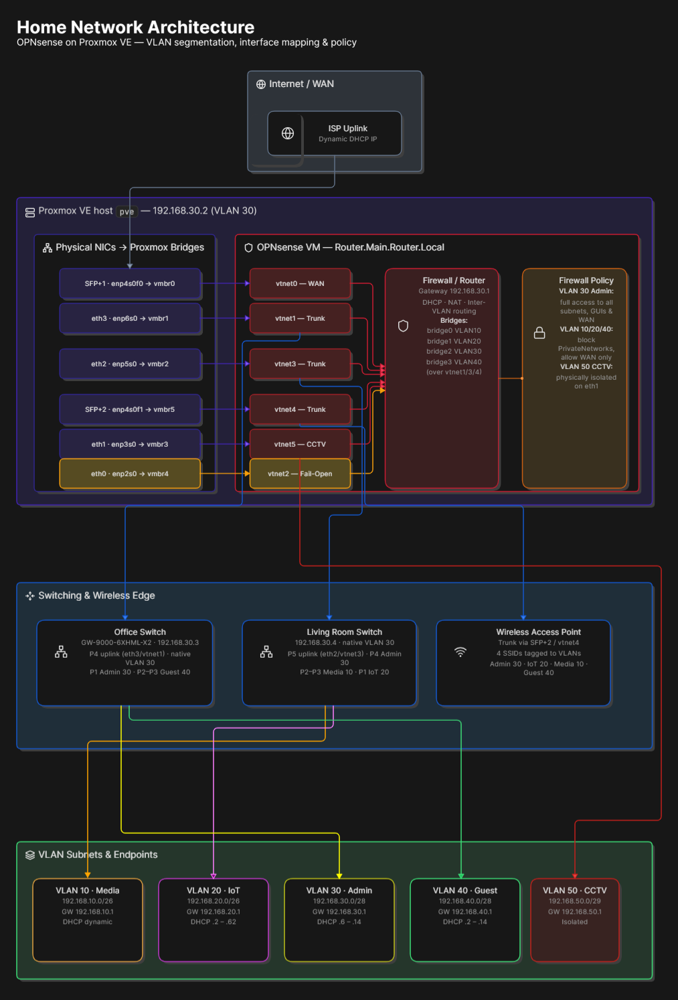
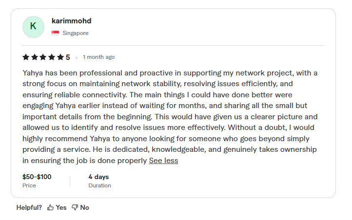
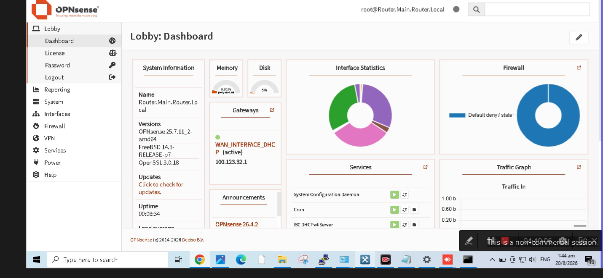
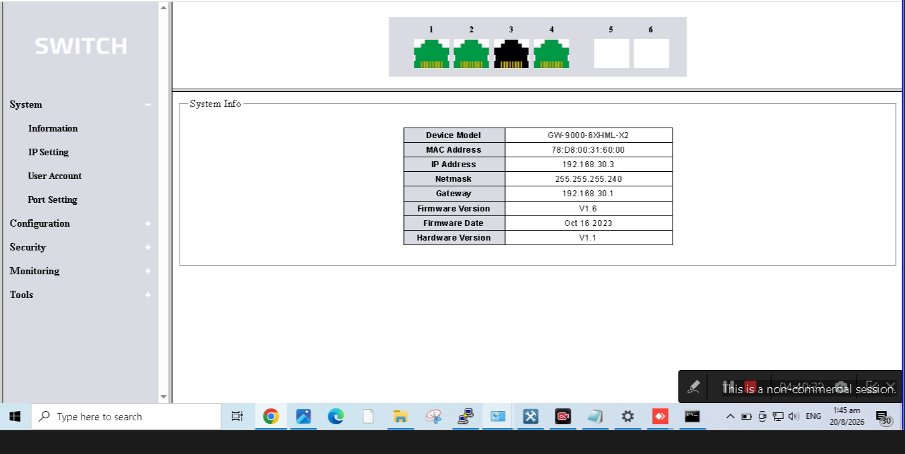
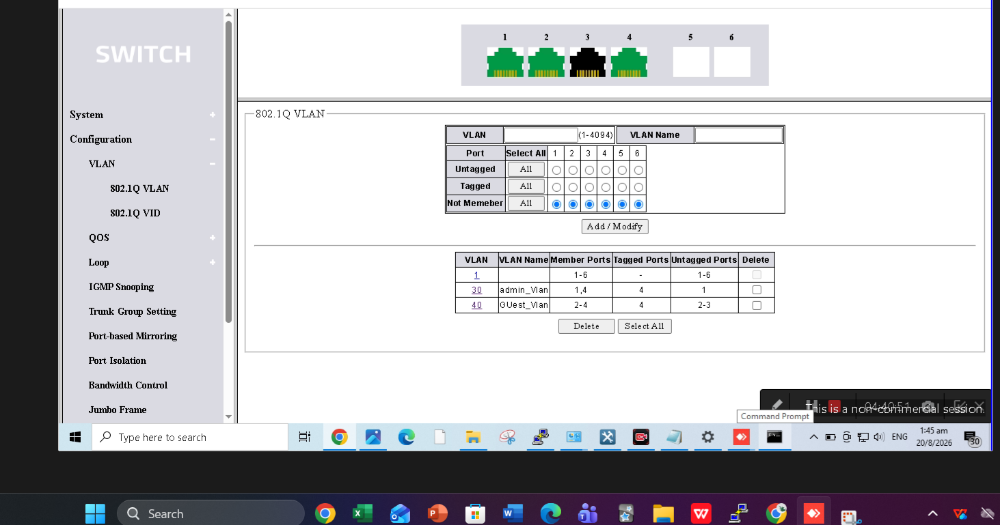
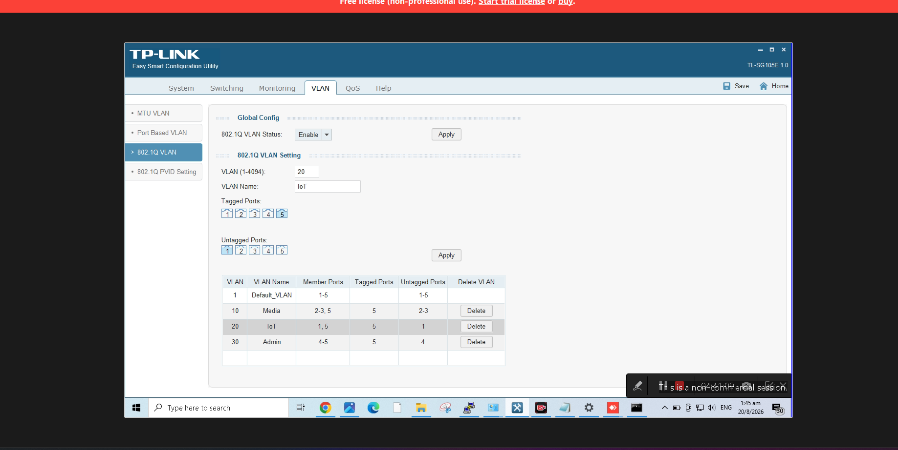
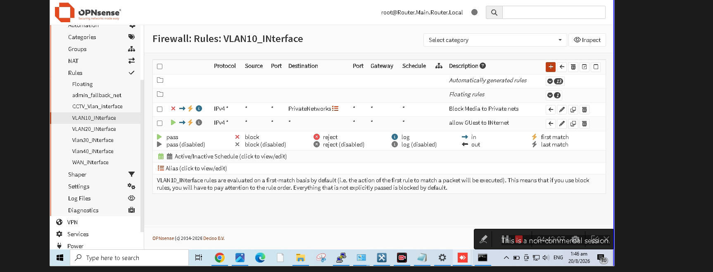
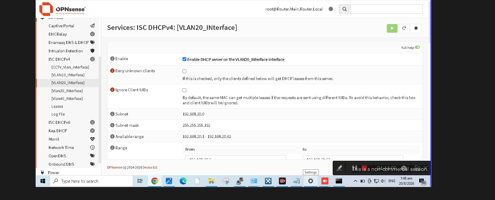
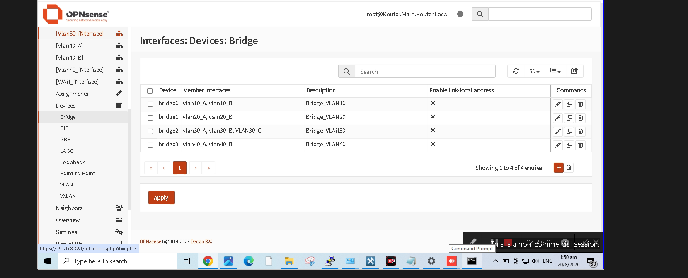

# OPNsense on Proxmox VE: VLAN-Segmented Network

Freelance project (Fiverr) for a small client: a segmented network built with OPNsense virtualized on Proxmox VE.

## Architecture

## Highlights
- OPNsense VM on Proxmox VE with 6 NICs mapped to dedicated bridges
- 5 VLANs: Media, IoT, Admin, Guest, CCTV
- Inter-VLAN routing controlled by firewall policy
- Trunks on two managed switches and a wireless AP (4 SSIDs, one per VLAN)
- Out-of-band fail-open management port
- CCTV physically isolated on its own interface

## Client Feedback

## Interface mapping
| Physical | Linux | Bridge | OPNsense | Function |
|---|---|---|---|---|
| eth0 | enp2s0 | vmbr4 | vtnet2 | Fail-open access |
| eth1 | enp3s0 | vmbr3 | vtnet5 | CCTV (VLAN 50) |
| eth2 | enp5s0 | vmbr2 | vtnet3 | Living room switch trunk |
| eth3 | enp6s0 | vmbr1 | vtnet1 | Office switch trunk |
| SFP+1 | enp4s0f0 | vmbr0 | vtnet0 | WAN |
| SFP+2 | enp4s0f1 | vmbr5 | vtnet4 | Access point trunk |

## VLANs
| VLAN | Name | Subnet |
|---|---|---|
| 10 | Media | 192.168.10.0/26 |
| 20 | IoT | 192.168.20.0/26 |
| 30 | Admin | 192.168.30.0/28 |
| 40 | Guest | 192.168.40.0/28 |
| 50 | CCTV | 192.168.50.0/29 |

## Firewall policy
| Source | Destination | Action |
|---|---|---|
| Admin (30) | All internal, management GUIs, WAN | Allow |
| Media / IoT / Guest (10/20/40) | RFC 1918 | Block |
| Media / IoT / Guest | WAN | Allow |
| CCTV (50) | All | Isolated |

## Testing

| T1 | OPNsense dashboard — firewall/gateway operational |

| T2 | Switch system info — management reachable |

| T3 | 802.1Q VLAN table on managed switch |

| T4 | TP-Link VLAN config (tagged/untagged ports) |

| T5 | Firewall rule — Media/IoT/Guest blocked from RFC1918 |

| T6 | DHCP scope active on VLAN20 (IoT) |

| T7 | OPNsense bridge aggregation of VLAN trunks |

## Challenges

- **Proxmox bridge / NIC mapping:** With six physical NICs feeding OPNsense through separate Proxmox bridges (vmbr0-vmbr5), an early misassignment between a physical interface and its intended vtnetX would break the entire VLAN chain for that trunk. Fixed by matching each physical port to its Proxmox bridge one at a time and confirming link state inside the OPNsense interface list before assigning any VLAN config — rather than mapping all six at once and troubleshooting blind.

- **Physical cabling vs. port naming:** Linux interface names (enp2s0, enp3s0, etc.) don't correspond 1:1 to physical port numbers printed on the NIC, so a cable plugged into "port 2" on the card might show up as enp5s0 in the OS. Resolved by testing link up/down on each cable individually while watching `ip link` / the Proxmox network tab, then documenting the physical-to-Linux mapping before touching any switch trunk config — this is what became the Interface Mapping table in the README.

- **VLAN bridging across trunks:** Each VLAN (e.g. Media, IoT) physically arrives at OPNsense on three different trunk ports — the office switch, the living room switch, and the AP — so a single VLAN sub-interface on just one trunk couldn't give all three physical paths a shared gateway. The fix was creating an OPNsense bridge per VLAN that groups together that VLAN's tagged sub-interface from each trunk, so traffic entering on any of the three physical paths lands on one logical interface with one gateway and one firewall policy, instead of needing three separate routed segments per VLAN.

## Tools
OPNsense · Proxmox VE · VLANs · Managed switches · Wireless AP